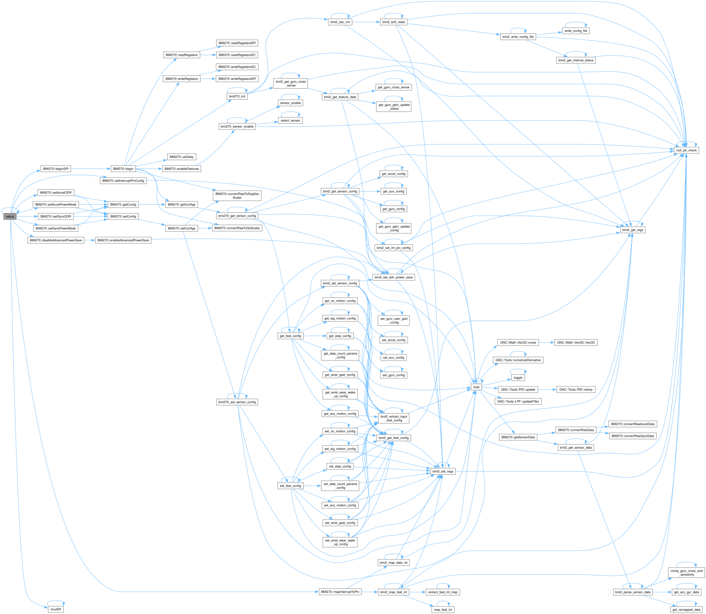
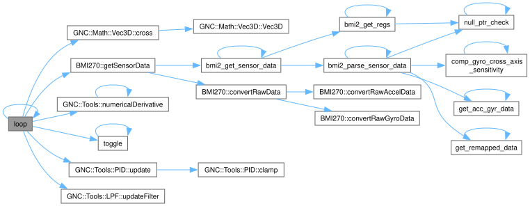

<!-- Banner info -->
# GNC_Project_Athena
Demonstrator code for a drone that is able to keep its attitude while experiencing outside forces such as wind.

<!-- Call graphs for arduino functions -->
# Call Graphs for Major Arduino Functions
> [!NOTE]
> There is a known bug in doxygen 1.18 where functions become self referential (e.g. loop points to itself when it really doesnt)

## Setup
The call graph of the setup function

## Loop Function Call graph
The call graph of the loop function
